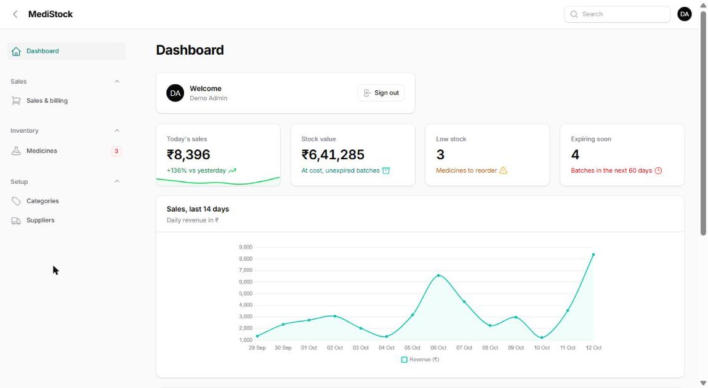
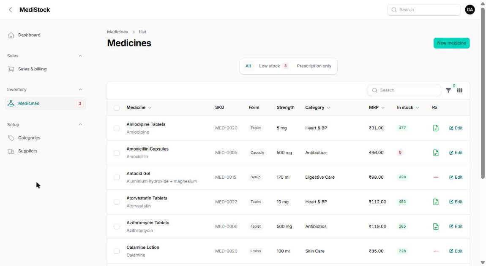
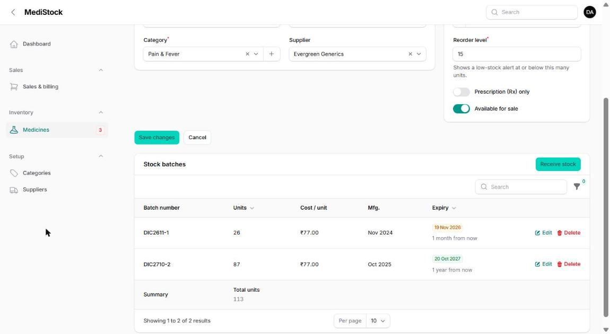
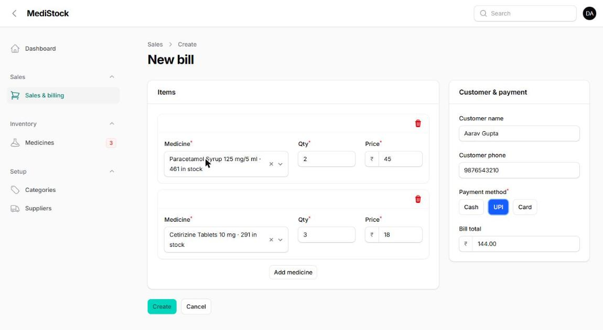
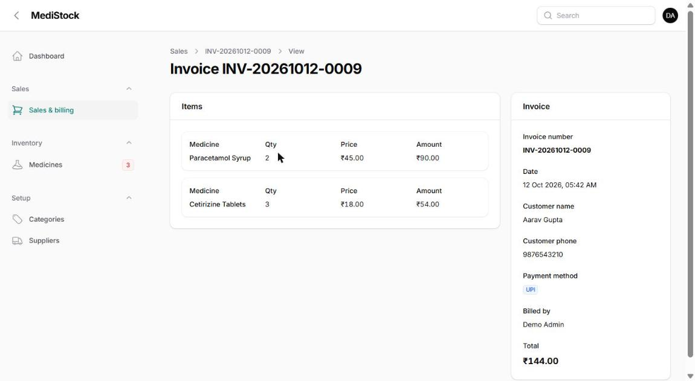

# MediStock — Pharmacy Inventory & Billing

Admin panel for a retail pharmacy, built with **Laravel 13** and **Filament 5**.
Tracks medicines by batch and expiry date, sells the oldest stock first, alerts on low and expiring stock, and creates bills with live totals.

**[Live demo](https://medistock-xiyz.onrender.com/admin)** — click **Sign in** (login is pre-filled).



## Features

- **Dashboard** — today's sales, stock value, low-stock and expiry alerts, 14-day revenue chart
- **Medicines** — search, filters, low-stock tab, Rx flag, sidebar reorder badge
- **Stock batches** — quantity, cost and expiry per batch; expired stock is never sold
- **Billing** — auto-filled prices, stock-checked quantities, live totals, invoice numbers
- **FEFO stock logic** — first expiry, first out, inside a database transaction
- **Setup** — categories and suppliers with GSTIN validation

| Medicines | Stock batches |
| --- | --- |
|  |  |

| New bill | Invoice |
| --- | --- |
|  |  |

## Tech stack

PHP 8.3+ · Laravel 13 · Filament 5 · Livewire 4 · Tailwind CSS · SQLite / MySQL · PHPUnit

## Setup

```bash
git clone https://github.com/contact-luckyram/pharmacy-inventory-filament.git
cd pharmacy-inventory-filament
composer run setup
php artisan serve
```

Open `http://127.0.0.1:8000/admin` and sign in with `admin@medistock.test` / `password`.

Run the tests with `php artisan test`.

## Project structure

```text
app/
├── Filament/
│   ├── Resources/   Medicines, Sales, Categories, Suppliers
│   └── Widgets/     Stats, sales chart, expiring batches
├── Models/          Medicine, Batch, Sale, SaleItem, Category, Supplier
└── Services/        StockService (FEFO deduction)
database/seeders/    Sample medicines, batches and 14 days of bills
```

## Contact

Built by **Lucky Ram** — Laravel & Filament developer, open to freelance projects.
[LinkedIn](https://linkedin.com/in/lucky-ram) · contact.luckyram@gmail.com

MIT License
